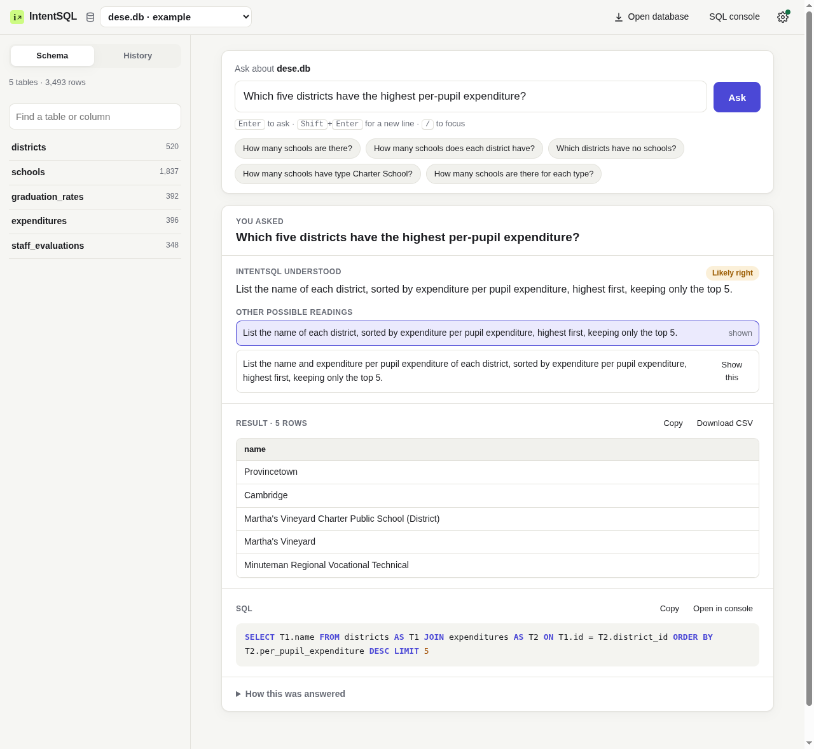

# IntentSQL

**Ask a SQLite database a question in plain English. See what IntentSQL understood, the SQL it ran, and the result.**

IntentSQL is a local application for querying your own SQLite databases. You ask a question such as "Which customers have never ordered a croissant?", "What is the average order value?" or "Who are the top 3 customers by total spending?". IntentSQL then:

- shows its reading of the question in plain English;
- shows how confident it is;
- shows the parameterized SQL it executed, read-only;
- shows the result, as a sortable table you can copy or export;
- offers other readings of the question when they would give a different answer.

It is built on **Jev**, TypeSafe's decision model ([what that is](https://docs.typesafe.ai/concepts/system-one)). Jev is used only for small, bounded decisions. Code inspects the database and proposes every possible column, value, relationship and operation. Jev chooses among those proposals, and code builds and validates the SQL from its choices. Jev never writes SQL and never invents a name. [ARCHITECTURE.md](ARCHITECTURE.md) explains the design.



## Quick start

You need Python 3.10 or newer and a Jev API key. To get a key, sign in to the [TypeSafe console](https://console.typesafe.ai/) and see the [quick start](https://docs.typesafe.ai/introduction/quickstart).

```bash
python3 -m venv .venv
.venv/bin/pip install -e .
.venv/bin/intent-sql serve            # http://127.0.0.1:7862
```

Open <http://127.0.0.1:7862>, click the gear icon and paste your key. The key is saved in your local IntentSQL workspace (`~/.local/share/intentsql`, or `%LOCALAPPDATA%\IntentSQL` on Windows) with owner-only permissions, and it is never sent back to the page. As an alternative, set `SYSTEM_ONE_API_KEY` in your environment or in a `.env` file (which git ignores).

The app opens with three example databases: Cyberchase, DESE and Moneyball. Use **Open database** to work on your own SQLite file. IntentSQL copies the file into its workspace and only ever reads the copy.

### Command line

```bash
intent-sql ask data/dese.db "Which five districts have the highest per-pupil expenditure?"
intent-sql ask data/dese.db "How many schools does each district have?" --json --debug
intent-sql schema data/moneyball.db
```

### Docker

```bash
docker build -t intentsql .
docker run --rm -p 127.0.0.1:7862:7862 -v intentsql-data:/data -e SYSTEM_ONE_API_KEY intentsql
```

## What it supports

Supported features include:
- filters, ranges, text matching, NULLs and DISTINCT;
- multi-hop joins over declared and inferred keys, self-joins (an employee and their manager) and outer joins;
- aggregates, grouping, HAVING and COUNT(DISTINCT);
- nested aggregates (average order value) and percentages;
- arithmetic measures (revenue = quantity × price, durations) and column-to-column comparisons;
- anti-joins ("never ordered"), INTERSECT and EXCEPT;
- correlated and scalar subqueries, and top-N per group;
- date parts, months and quarters, and relative periods.

[docs/CAPABILITIES.md](docs/CAPABILITIES.md) lists each feature with examples, along with the **known limitations**.

IntentSQL reads data and never changes it. Requests to modify data are refused, and every query runs on a read-only SQLite connection with row and time limits.

## How good is it?

These numbers were measured on 2026-10-10 with `jev-latest`. They are execution accuracy: the result rows must match the reference query's rows.

| Evaluation | Result |
|---|---|
| **Spider dev** (validation, never inspected case by case; 2 random batches of 300) | **76.8% ± 2.6** overall; easy 84.0, medium 80.6, hard 73.5, extra-hard 59.4 |
| Confident answers on Spider dev | 86% of questions answered confidently, **86.0%** of those correct; the other 14% are flagged *uncertain* and offer alternatives |
| Accuracy when answering only the most confident questions (dev) | 88.3% at 80% coverage, 91.7% at 70%, 94.9% at 50% |
| Spider train (development; fresh random samples) | 74–79% per batch of 300 |
| Capability suite (`features.json`, development) | 92.9% of 56 cases |
| Adversarial suite (`adversarial.json`, development) | 95.4% of 65 cases; 5 of 6 unsupported requests refused, no false refusals |
| Cost per question | 2.0 Jev calls, about 8,200 input tokens; latency p50 0.58 s, p95 0.81 s |
| For comparison: the Alpha this replaced | 33.8% on a random Spider train sample, 0% on hard and extra-hard |

**Not yet measured.** The frozen held-out suite (`holdout.json`, on a schema never used during development) and the Spider test milestone could not be run: the TypeSafe account ran out of API credits during the final assessment. [docs/EVALUATION.md](docs/EVALUATION.md) gives the exact commands.

What the numbers mean:
- About one answer in eight that IntentSQL presents as confident is wrong on Spider. Always read the "IntentSQL understood" line.
- Most remaining errors involve the choice of output column or grouping key, or Spider's own conventions (whether to show the ranked value, DISTINCT, and gold-query mistakes). Some readings are genuinely ambiguous.
- Extra-hard questions (unions and intersections of differently aggregated subqueries, deep nesting) remain the weakest area.

The evaluation protocol is in [docs/EVALUATION.md](docs/EVALUATION.md): which data was used for development, which was held out, and how scores are computed. The experiments behind the design, including the ones that failed, are in [docs/EXPERIMENTS.md](docs/EXPERIMENTS.md).

## Development

```bash
.venv/bin/pip install -e ".[dev]"
.venv/bin/python -m pytest          # offline tests: Jev is replaced by a scripted double
.venv/bin/ruff check .
.venv/bin/mypy intentsql

# benchmarks (need a key; Spider data under ../IntentSQL-artifacts/spider)
intent-sql benchmark --split train --size 300 --random --batches 2
intent-sql benchmark --suite benchmarks/suites/features.json --show-failures
python benchmarks/fixtures/build_suites.py     # rebuild fixtures and validate every gold query
```

| Path | Contents |
|---|---|
| `intentsql/` | grounding, interpretation, intent → IR → SQL, verification, Jev client, web API, CLI |
| `static/` | the web interface (no build step) |
| `tests/` | offline tests with a scripted Jev double |
| `benchmarks/` | hand-written suites and their fixture databases |
| `scripts/`, `experiments/` | failure analysis and the experiments recorded in docs/EXPERIMENTS.md |

## License

The code is under the [MIT license](LICENSE). The bundled `cyberchase.db`, `dese.db` and `moneyball.db` come from [Harvard CS50's Introduction to Databases with SQL](https://cs50.harvard.edu/sql/) under the course's [CC BY-NC-SA 4.0 license](https://cs50.harvard.edu/sql/license/), which applies to them separately from the code. They are unmodified.
