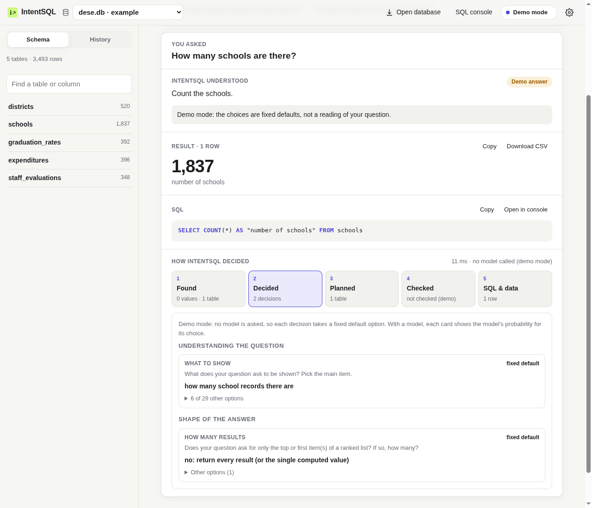
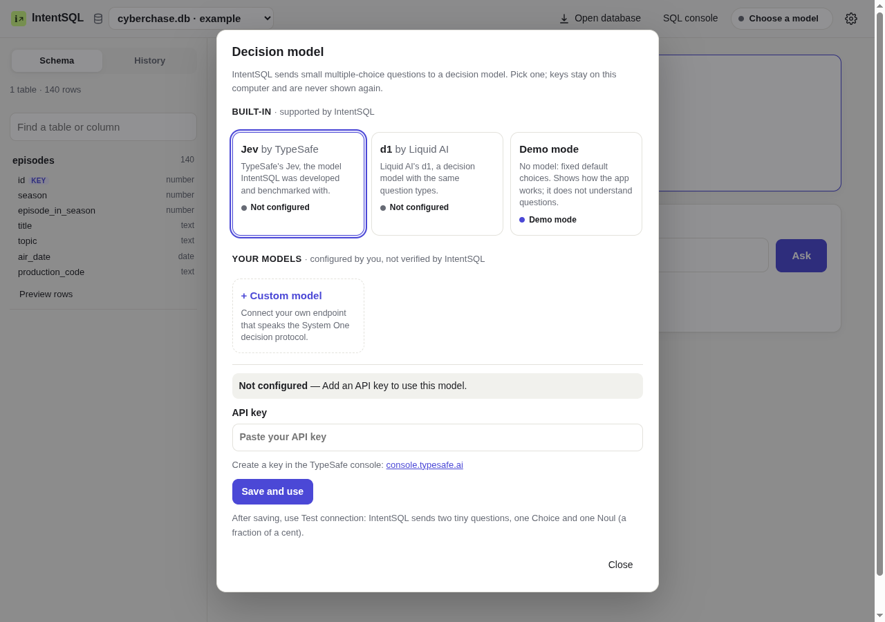

# IntentSQL

**Ask a SQLite database a question in plain English. See what IntentSQL understood, every decision behind it, the SQL it ran, and the result.**

> **Beta: 1.0.0-beta.1.** The software is complete and tested offline, but accuracy has not been re-measured on this exact build: see [Status of this Beta](#status-of-this-beta). Interpretations can be wrong, so check results that matter.


<sub>Screenshot in demo mode, which uses no model: the decisions are fixed defaults. With a model, each decision card shows the model's probability for its choice.</sub>

## How it works

IntentSQL never asks a language model to write SQL. Instead:

1. **Grounding.** Code reads the database and your question. It finds the values you mention (names, numbers, dates, periods) and the tables and columns they belong to.
2. **Bounded decisions.** Code builds every reasonable option: which column to show, which value filters which column, how to group, sort, or join. A *decision model* answers small multiple-choice questions about which option your question means, all in one parallel round.
3. **Typed interpretation.** Code assembles the answers into a typed plan (the *Intent*) and describes it in plain English.
4. **Deterministic SQL.** A compiler turns the plan into parameterized SQLite. It picks joins from the database's keys, and every value is a bound parameter.
5. **Verification.** IntentSQL also runs the readings that differ by one decision and give *different results*. The model checks the plain-English readings against your question. Uncertain answers are flagged, with the alternatives offered.
6. **Read-only results.** The query runs on a read-only connection with row and time limits. Requests to change data are refused.

The app's **How IntentSQL decided** panel shows each stage:
- what was found;
- each decision, with the options offered and the model's probabilities;
- the plan and its joins;
- the verification;
- the SQL.

Per-decision probabilities are not the chance that the whole answer is right. [ARCHITECTURE.md](ARCHITECTURE.md) has the details.

## Install

You need Python 3.10 or newer. IntentSQL is not on PyPI; install it from a clone:

```bash
git clone https://github.com/Amine-LG/IntentSQL.git && cd IntentSQL
python3 -m venv .venv
.venv/bin/pip install .
.venv/bin/intent-sql serve            # http://127.0.0.1:7862
```

Or with Docker. Publish the port on localhost only, because the app stores model keys:

```bash
docker build -t intentsql .
docker run --rm -p 127.0.0.1:7862:7862 -v intentsql-data:/data intentsql
```

The app opens with three example databases: Cyberchase, DESE and Moneyball. **Open database** imports your own SQLite file; IntentSQL copies it into its workspace and only reads the copy.

## Connect a decision model

On first start, IntentSQL asks you to choose a model. Nothing is chosen silently.



| Choice | Model | Get a key | Status in this Beta |
|---|---|---|---|
| **TypeSafe** | Jev (`jev-latest`) | [console.typesafe.ai](https://console.typesafe.ai) | Used to develop and measure IntentSQL (historical) |
| **Liquid AI** | d1 (`d1`, `d1:free`) | [console.liquid.ai](https://console.liquid.ai) | Implemented and tested offline; not yet validated live |
| **Demo mode** | none | — | Fixed default choices, so you can explore the app. It does not understand questions. |
| **Custom model** | yours | — | Any endpoint that implements the System One decision protocol. Configured by you, not verified by IntentSQL |

- **In the app:** click the model button at the top right, paste a key, **Save**, then **Test connection**. Test connection sends one tiny question of each decision type, costing a fraction of a cent. The state reads *Connected* only after a real answer. Otherwise it shows *Key rejected*, *No credits*, *Unavailable*, *Incompatible* or *Not configured*, with the provider's own message.
- **On the command line:**
  ```bash
  intent-sql keys typesafe        # or: liquid, demo. The key is typed without echo
  intent-sql provider --test      # one tiny question per decision type
  ```
- **With environment variables** (servers, Docker): set `SYSTEM_ONE_API_KEY` (TypeSafe) or `LIQUID_API_KEY`. `INTENTSQL_PROVIDER=typesafe|liquid|demo|custom:<id>` locks the choice; the app then says so. Optionally, `INTENTSQL_BUDGET_USD` stops requests at a spending limit.

**Your own model.** IntentSQL is not locked to these providers. Choose **+ Custom model** in the setup dialog, or run `intent-sql custom add`, and enter:
- your endpoint's URL;
- its model ID;
- an optional key.

Any endpoint that speaks the System One decision protocol (Choice and Noul questions, with probabilities) can be used. *Test connection* checks that its answers have the right format and reports *Incompatible* otherwise. Chat-completion APIs do not implement this protocol. A passing test says nothing about decision quality, and confidence is not calibrated for custom models. [docs/CUSTOM_MODELS.md](docs/CUSTOM_MODELS.md) describes the protocol.

**Key handling:**
- Keys are stored server-side, in a file only you can read (mode 0600, in IntentSQL's workspace).
- Keys are sent only to their own provider.
- Keys are never returned to the browser, logged, or written to reports or `localStorage`.
- IntentSQL never switches provider on its own. Demo mode is used only when you choose it.

## Command line

```bash
intent-sql ask dese.db "Which five districts have the highest per-pupil expenditure?"
intent-sql ask dese.db "How many schools does each district have?" --json --debug
intent-sql schema moneyball.db       # bundled examples by name, or a path to any SQLite file
intent-sql --version
```

## What it supports

- filters, ranges, text matching, NULLs and DISTINCT;
- multi-hop, self- and outer joins over declared and inferred keys;
- aggregates, grouping, HAVING, COUNT(DISTINCT), nested aggregates and percentages;
- derived measures (quantity × price, durations) and column-to-column comparisons;
- anti-joins ("never ordered"), INTERSECT and EXCEPT, correlated and scalar subqueries;
- top-N per group, date parts, quarters and relative periods.

Each feature, with examples and **known limitations**, is listed in [docs/CAPABILITIES.md](docs/CAPABILITIES.md).

## Status of this Beta

| | |
|---|---|
| **Implemented and tested offline** | Everything above: 145 tests with a scripted model double; ruff and mypy clean; browser-tested on desktop and mobile, in light and dark themes; clean wheel install; Docker image; CLI and API smoke tests in demo mode and with custom models against a local protocol stub |
| **Validated over real HTTP** | Custom models: add, test, select, edit and remove, against a local protocol stub and a chat-style API (reported *Incompatible*), in the browser and in the smoke test. Liquid AI d1: the real endpoint and its key-rejection path, with an invalid key. No d1 answers yet, because no Liquid key was available |
| **Measured historically (TypeSafe Jev)** | The results below, on code from 2026-10-09. The code has changed since (provider layer, module split, new features covered by offline tests). The latest build has not been measured, because the TypeSafe account had no credits (HTTP 402) |

### Historical results

Spider dev, TypeSafe `jev-latest`, two fresh random batches of 300, measured on 2026-10-09. Execution accuracy means the result rows must match the reference query.

| | |
|---|---|
| Overall | **76.8% ± 2.6** (easy 84, medium 81, hard 74, extra-hard 59) |
| Confident answers | 86% of questions; **86.0%** of those correct. The rest were flagged *uncertain*, with alternatives |
| Most confident 70% of questions | 91.7% correct |
| Cost | about 2 model calls and 8,200 input tokens per question; p50 latency 0.6 s |

**Improvement over the Alpha.** The Alpha (`v0.1.0-alpha.1`) scored 33.8% on 80 Spider train questions (0% on hard and extra-hard). The numbers are not directly comparable: different split, a much smaller sample, and an earlier code base. The same-sample comparison and every run are in [docs/EVALUATION.md](docs/EVALUATION.md#results).

About one confident answer in seven was wrong on Spider dev. Always read the "IntentSQL understood" line.

## Limitations

- SQLite only. One question at a time; no follow-up questions about a previous answer.
- Without a model, only demo mode works, and it does not understand questions.
- Extra-hard questions (unions of differently aggregated subqueries, deep nesting) remain the weakest area.
- Results for Liquid AI d1 and for custom models are unknown until they are measured. Confidence is not calibrated for them, so they show the raw verification score.
- [docs/CAPABILITIES.md](docs/CAPABILITIES.md) lists unsupported SQL features.

## Development

```bash
.venv/bin/pip install -r requirements-dev.txt -e .
.venv/bin/python -m pytest          # offline: the model is replaced by a scripted double
.venv/bin/ruff check . && .venv/bin/mypy intentsql
scripts/smoke.sh                    # CLI and API smoke test in demo mode (no key, no network)
scripts/release_eval.sh liquid      # the live evaluation protocol, for one provider (spends credits)
```

CI (`.github/workflows/ci.yml`) runs tests, lint, type checks, a clean install, the smoke test, a Docker build, a secret scan over the full history, and a dependency audit. It uses no API keys and makes no paid calls. [docs/SECURITY.md](docs/SECURITY.md) covers key handling and the pre-release audit.

## License

The code is under the [MIT license](LICENSE). The bundled `cyberchase.db`, `dese.db` and `moneyball.db` come from [Harvard CS50's Introduction to Databases with SQL](https://cs50.harvard.edu/sql/). They are under the course's [CC BY-NC-SA 4.0 license](https://cs50.harvard.edu/sql/license/), separately from the code, and are included unmodified ([notice](intentsql/data/NOTICE.md)).
