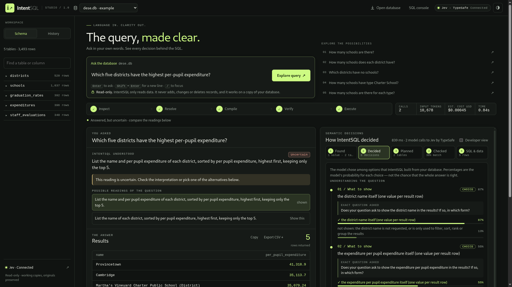

# IntentSQL 1.0.0

The first stable release. You ask a SQLite database a question in plain English, and IntentSQL shows how the answer was reached:
- the values it found;
- every decision, with the exact question it asked and the model's probabilities;
- the plan and its joins, and the verification;
- the read-only SQL it ran.



## Highlights

- **Code proposes, the model chooses, code builds.** A decision model only picks among options that code built from your database. A typed plan compiles to parameterized, read-only SQL. Alternative readings that give different results are run and checked, and the answer carries a calibrated confidence.
- **Validated with TypeSafe Jev** (`jev-1.13.0`) on frozen code:
  - **93.3%** on a held-out suite written for an unfamiliar schema (42/45);
  - **78.0%** on a 600-question Spider test sample (public labels; not an official leaderboard score);
  - 87.5% of confident answers correct.
- **Open to any compatible model.** TypeSafe Jev (recommended) and Liquid AI d1 are built in. You can add your own System One endpoint in the app or the CLI, and IntentSQL tests whether it answers in the right format. Demo mode is clearly labelled, and there is never a silent fallback.
- **The Alpha's look, the 1.0's usability.** The green-black and lime studio palette and the decision timeline are back. They come with the newer layout:
  - on wide screens the answer sits beside its decisions;
  - model setup, history, CSV export and alternative readings;
  - layouts from phone to 2560 px, in light and dark themes.
- **Safe by construction.** Execution is read-only with row and time limits. Keys stay server-side. Writes from other sites or local ports are blocked. There is a cumulative spending guard.

## Since the Alpha (v0.1.0-alpha.1)

| | Alpha | 1.0.0 |
|---|---|---|
| SQL coverage | one join hop, flat filters, simple aggregates | multi-hop, self- and outer joins; subqueries; INTERSECT/EXCEPT; anti-joins; nested aggregates; percentages; derived measures; top-N per group; periods |
| How the model is used | a multi-step planner loop | one parallel round of bounded choices, plus verification |
| Confidence | none | calibrated per model; uncertain answers flagged, with alternatives |
| Data access | reads and confirmed writes | read-only |
| Spider train, the Alpha's 80 questions | 33.8% (0% on hard and extra-hard) | 77.5% early in the rewrite; 76.8% on 600 train questions now |

The two systems were not measured on identical benchmarks, so the comparison is indicative ([docs/EVALUATION.md](EVALUATION.md#compared-with-the-alpha)).

## Known limitations

- SQLite only; one question at a time.
- Between one in eight (Spider test) and one in five (fresh Spider dev sample) confident answers are wrong. Check the "IntentSQL understood" line for results that matter.
- Extra-hard questions (62–65%) are the weakest area.
- Only TypeSafe Jev is measured and calibrated. Liquid d1 and custom models are supported but not validated.

## Install

```bash
git clone https://github.com/Amine-LG/IntentSQL.git && cd IntentSQL
python3 -m venv .venv && .venv/bin/pip install .
.venv/bin/intent-sql serve
```

See [INSTALL.md](INSTALL.md) for Docker, configuration and troubleshooting.
